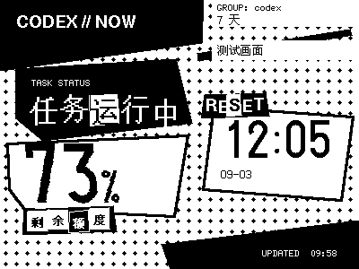
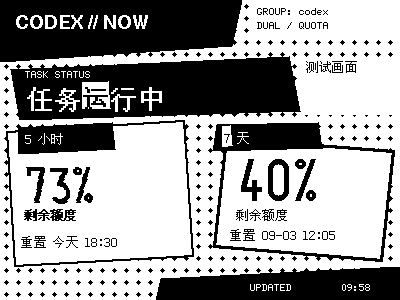
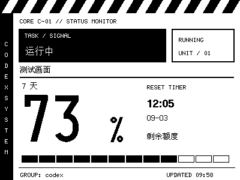
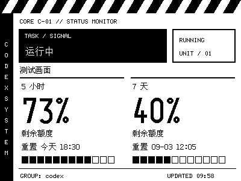
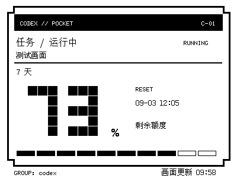
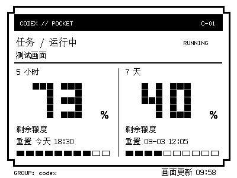
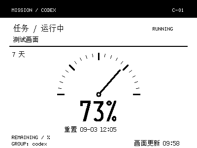
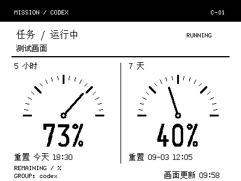
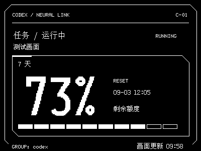
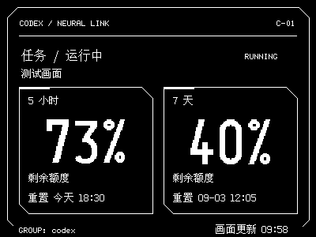

# Codex NOTE4 指示牌

把 Codex 的额度和可验证的任务状态显示在 ZECTRIX NOTE4 电子纸上。

Windows 图形控制台 `0.3.0-rc.5` 候选版：下载 ZIP、解压、双击程序，按中文向导完成配置即可。使用者不需要安装 Rust、Python 或 Node.js。

**[下载 Windows x64 安装包](https://github.com/zwe-zy/codex-zectrix-dashboard/releases/download/v0.3.0-rc.5/codex-zectrix-dashboard-0.3.0-rc.5-windows-x86_64.zip)** · [版本说明与 SHA256 校验文件](https://github.com/zwe-zy/codex-zectrix-dashboard/releases/tag/v0.3.0-rc.5)

## Windows 使用

1. 安装 Windows 版 Codex，并登录自己的 ChatGPT 账号。
2. 在 [ZECTRIX 极趣云](https://cloud.zectrix.com)的「开放 API」创建 Key，并确认 NOTE4 已绑定、在线。
3. 从本仓库 Releases 下载 `codex-zectrix-dashboard-版本-windows-x86_64.zip`，**完整解压**。不要只取一个 EXE，也不要在 ZIP 内直接运行。
4. 双击 **`NOTE4控制台.exe`**，点击“安装并开始”。在设备配置页检查 Codex 登录、粘贴 Key、选择设备和页面，再预览并确认上传。

配置完成后自动启动后台。以后可从开始菜单搜索 **Codex NOTE4** 打开控制台。四个页面提供运行总览、墨卡与主题、设备配置、设置与诊断。关闭窗口不影响后台；Key 输入会遮挡，保存在 Windows 凭据管理器中。

目前提供 Windows x64 候选包。正式稳定版发布前还需独立新用户、登录启动和休眠唤醒验收。候选包尚未进行代码签名。

完整说明见 [Windows 安装、升级与排错](docs/windows.md)。源码构建者见下方；原有 macOS 插件见 [历史使用说明](docs/macos-plugin.md)。Linux 和 macOS 的统一安装体验安排在 Windows 验收之后，本次不提供这两个平台的新发布包。

## 屏幕显示什么

- 在 **墨卡与主题** 页预览并应用 **怪盗剪贴、EVA 机库终端、像素掌机、航天仪表、赛博 HUD**。五种风格都支持单额度、双额度，选择在升级和重启后保留。预览点击不会上传；示例图有明确标识。
- **选择 1 张**：直接选择设备墨卡编号和风格，点击 **保存并应用**。**选择 2 / 3 / 4 / 5 张**：直接显示对应数量的墨卡，每张独立选风格，拖动排序或点击上移 / 下移；从上到下对应设备墨卡 1–N。保存后更新所列页面，其余页面保留最后画面并停止更新。编辑和预览不会立即上传，状态刷新不会覆盖未保存的排列。
- Codex 配额组的两个窗口分别显示剩余百分比和重置时间；上游只返回一个窗口时显示一个。
- 任务显示执行中、空闲、本轮已完成、失败、已中断或暂不可用。只有能确认的近期结束事件才显示完成；无法观察到的 Desktop 状态不会猜测。
- 初次确认上传的是带“测试画面”标记的样张，随后由后台替换为实时信息。
- 额度每 10 分钟读取一次，任务每分钟读取一次。内容变化后上传，至少间隔 60 秒；内容未变不会持续刷屏。网络故障自动退避重试。

多张模式共用一次数据读取，每张分别去重、限制上传频率及失败重试。一次更新最多上传五张不同页面；每张至少间隔 60 秒，Key 被拒绝时全部暂停。总览可查看最近成功上传的图片；云端上传成功不代表实体屏幕已经刷新。控制台每两秒读本地状态，不额外启动持续观察会话。

Windows 画面不包含任务标题、对话、项目路径或重置雷达。云端接收渲染后的 400×300 黑白 PNG，以及发送所需的设备和页面标识。

以下为程序生成的模拟画面，百分比仅用于展示。单额度示例为 7 天，双额度示例为 5 小时 + 7 天；实际时长以接口为准，缺失时显示未知。怪盗双额度的第二张卡片沿用单额度 RESET 的斜框样式；EVA 保留对称终端布局。

| 主题 | 单额度 | 双额度 |
| --- | --- | --- |
| 怪盗剪贴风 |  |  |
| EVA 机库终端风 |  |  |
| 像素掌机风 |  |  |
| 航天仪表风 |  |  |
| 赛博 HUD 风 |  |  |

## 开发与验证

在 Windows x64 安装 Rust（验证版本 1.99.1）和 Visual Studio C++ Build Tools 后执行：

```powershell
cargo fmt --check
cargo clippy --locked --all-targets --all-features -- -D warnings
cargo test --locked --all-targets --features test-support
cargo test --locked --all-targets --features desktop,test-support
powershell -NoProfile -ExecutionPolicy Bypass -File scripts/build-release-windows.ps1
powershell -NoProfile -ExecutionPolicy Bypass -File scripts/test-windows-package.ps1
```

发布 ZIP 和 `SHA256SUMS` 位于 `target/windows-release`。包内共七个文件：控制台、原 CLI、companion、LICENSE、THIRD-PARTY-NOTICES.txt、快速入门及 package.json；不收录个人配置、凭据、日志或开发缓存。旧五文件包仍可升级。Windows GitHub Actions 执行同样的校验并保存候选 artifact，不会自动发布正式 Release。

## 来源与许可

基于 [BarryBarrywu/codex-zectrix-dashboard](https://github.com/BarryBarrywu/codex-zectrix-dashboard) 开发，保留原作者版权和 [MIT 许可证](LICENSE)。本项目为第三方工具，与 OpenAI、ZECTRIX 官方无隶属关系。
