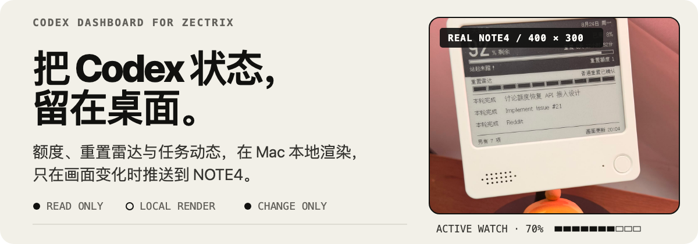
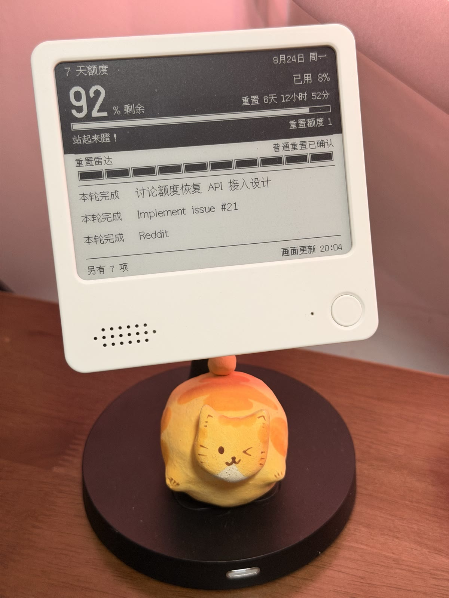
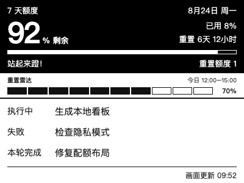
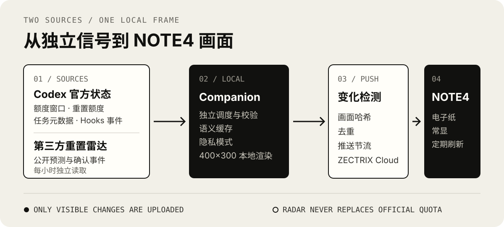

# 原有 macOS 插件说明

本页保留上游 macOS 插件的使用说明和历史实机效果。Windows 候选版请使用仓库首页的独立 ZIP；这里的雷达、任务标题和插件安装步骤不适用于 Windows 菜单版。macOS 尚未完成本次修改后的实机回归。

<p align="center">
  
</p>

<p align="center">
  
  
  
  
</p>

不用反复打开 Codex，也能在桌面上看到剩余额度、重置时间、非官方重置雷达和最近任务动态。插件内置 macOS companion，在本地读取与渲染 400×300 黑白画面，只在可见内容变化时推送到 ZECTRIX NOTE4。

<p align="center">
  <a href="#安装"><strong>安装</strong></a> ·
  <a href="#工作方式"><strong>工作方式</strong></a> ·
  <a href="#重置雷达"><strong>重置雷达</strong></a> ·
  <a href="#隐私与边界"><strong>隐私与边界</strong></a>
</p>

<a id="实机效果"></a>

<p align="center">
  
</p>

<p align="center">
  
</p>

这是 companion 读取当前 Codex 状态后生成并推送到开发用 NOTE4 的实际画面。设备选择、持久 `pageId`、首次推送和每台实体屏幕的可读性仍需在各自安装环境中确认。

### 400×300 看板视觉原型

<p align="center">
  
</p>

这张图用于展示已经过实机迭代的信息层级与间距。正式画面由 Rust 渲染器生成，因此字体栅格和个别像素可能略有差异。

- 官方 Codex 配额：剩余与已用百分比、窗口时长、计划重置时间和可用重置额度
- 独立重置雷达：活跃预测、普通重置、重置额度、暂无预测或信号不可用
- 最多三条任务动态：`执行中`、`本轮完成`、`失败`或`已中断`
- 数据暂时不可用时保留仍然有效的上次状态，不用零值冒充当前结果
- 隐私模式隐藏任务标题，同时保留状态与数量

<a id="工作方式"></a>

<p align="center">
  
</p>

<p align="center">
  
</p>

三类状态独立观察，互不拖累：

| 信息 | 读取频率 | 用途 |
| --- | ---: | --- |
| 官方额度 | 每 10 分钟 | 显示账户配额窗口、重置时间和重置额度 |
| 任务活动 | 每 30 秒 | 捕捉顶层任务最近一次受支持的执行状态 |
| 重置雷达 | 启动时及每小时 | 读取公开的第三方预测与确认事件 |

companion 复用一个持久的 `codex app-server` 会话，并休眠到最近的观察期限。状态在 Mac 本地归一化、缓存和渲染；只有画面真的发生变化并通过推送节流后，才上传到选定的 ZECTRIX 页面。

NOTE4 的刷新频率只是设备检查云端新画面的频率，不代表 companion 会同频上传。画面中的“画面更新”表示最近一次成功上传变化画面的时间。

## 重置雷达

重置雷达与官方账户额度完全独立。它读取 [Codex Resets](https://codex-resets.com/) 的[公开状态 API](https://codex-resets.com/api/docs)：上游观察 `@thsottiaux` 的公开 X 帖子，并用 AI 将内容分类为“可能发生重置”或“已经确认重置”。

这不是 OpenAI 的承诺，也不是针对当前账户计算出的重置时间。上游没有公开所用模型、提示词或 `elevated`、`strong` 的具体阈值；Dashboard 不自行猜测概率，只验证并展示 API 返回的有效信号。

| 屏幕状态 | 判定规则 | 保留时间 |
| --- | --- | --- |
| 活跃预测 | 等级为 `elevated` 或 `strong`，预测窗口和时间字段有效，且当前时间尚未越过 `expires_at` | 显示至上游有效期结束；只有比确认事件更新的预测才能覆盖确认状态 |
| 普通重置已确认 | 最新事件为 `regular`，且没有更新的活跃预测 | 从 `announced_at` 起 24 小时 |
| 重置额度已确认 | 最新事件为 `banked`，表示获得可稍后使用的重置额度，并非立即补满 | 从 `announced_at` 起 24 小时 |
| 暂无活跃预测 | API 明确返回 `active_watch: null`，且本次观察仍然新鲜 | 最近一次成功确认后 2 小时 |
| 雷达信号丢失 | 没有有效预测、确认事件或新鲜的“无预测”结果 | 直到取得下一份可验证数据 |

十格信号尺每格代表 10%，采用向上取整：`1%–10%` 显示一格，`61%–70%` 显示七格。上游未给出概率时，只显示预测窗口。网络请求失败时，仍在自身有效期内的预测或确认可以继续显示，但不会无限保留；“暂无活跃预测”不会跨重启被当作新鲜结果。

<a id="安装"></a>

<p align="center">
  
</p>

需要：

- macOS 与 Codex
- 一台 ZECTRIX NOTE4
- 从 [ZECTRIX 极趣云平台](https://cloud.zectrix.com)「开放 API」创建的 API Key

API Key 等同账号密码，请勿粘贴到聊天中或提交到代码仓库。完整接口说明参见 [ZECTRIX 官方 API 文档](https://wiki.zectrix.com/zh/software/api-docs)。

```sh
codex plugin marketplace add BarryBarrywu/codex-zectrix-dashboard
codex plugin add codex-zectrix-dashboard@codex-zectrix-dashboard
```

安装完成后，在 Codex 中运行：

```text
$setup-zectrix-dashboard
```

setup 会在本机无回显终端中收集 API Key，将它保存到 macOS Keychain，自动列出兼容设备，并在首次上传前展示预览和发送边界。只有你确认后，画面才会发送到 NOTE4。

### 更新

再次运行 `$setup-zectrix-dashboard`，按照 guarded update 流程操作。更新期间需要 reload 或 restart Codex；不要直接删除旧插件缓存，也不要预先运行 `codex plugin marketplace upgrade`。

### 不连接设备也能试用

从源码生成固定示例：

```sh
cargo run --locked --release -- preview \
  --input fixtures/sample-dashboard.json \
  --output preview.png
```

读取当前 Codex 配额并生成本地实时预览：

```sh
cargo run --locked --release -- live-preview --output live-preview.png
```

`live-preview` 不连接 Codex Desktop 或 ZECTRIX 设备。从源码运行需要 Rust；安装正式插件不需要另行安装 Python、Node.js 或 Rust。

<a id="隐私与边界"></a>

<p align="center">
  
</p>

默认画面包含任务标题，渲染后的 PNG 会上传到 ZECTRIX Cloud。启用隐私模式后，标题会替换为“隐私任务”，但配额、任务状态和计数仍会显示。

程序只处理配额窗口、重置数据、任务标题和受限的任务活动状态。它不会保存或显示提示词、回复、推理、工具参数、计划文本或项目路径。ZECTRIX API Key 保存在 macOS Keychain；诊断输出不包含账户、设备 ID、原始雷达响应或其他原始载荷。

### 当前限制

- 仅支持 macOS 和 ZECTRIX NOTE4
- 不同步 Codex Desktop 的未读蓝点
- 暂不提供权威的“待你”“检查”状态或计划进度
- 不能修改、控制或结束 Codex 任务
- 自动化测试、分发包验证和 NOTE4 实机验证是三个独立验收边界

<a id="验证"></a>

<p align="center">
  
</p>

```sh
cargo test --locked --all-features
./scripts/build-release.sh
./scripts/test-clean-install.sh
```

0.1.9 的布局与 changed-frame 上传路径已在开发用 NOTE4 上运行验证。fixture、fake ZECTRIX、通用分发包和一次开发机实测都不能替代每台新设备的独立安装验收。

## 关注我们

- [极趣实验室（硬件官方）](https://space.bilibili.com/13131424)：ZECTRIX 墨水屏、桌搭硬件和开源玩法
- [最近使用（项目作者）](https://space.bilibili.com/217963572)：苹果生态、AI 工具与效率实践

## License

[MIT](../LICENSE)
